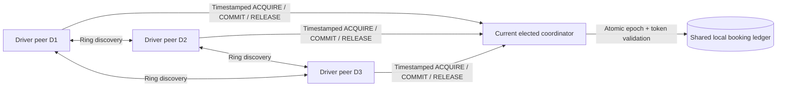

# CECS 327 - Distributed Ride-Matching System

**Milestone 4: Distributed Coordination, Logical Clocks, Leader Election & Mutual Exclusion**

This milestone extends the peer-to-peer driver overlay from Milestone 3 with distributed coordination mechanisms. Each peer node maintains a thread-safe Lamport logical clock, attaches logical timestamps to peer messages, participates in a numeric Bully leader election algorithm, and coordinates access to a shared durable SQLite driver booking ledger using centralized mutual exclusion with 5-second leases and epoch fencing.

---

## 1. Required Software
* **Python 3.10+** (Tested on Python 3.14+)
* **Visual Studio Code** (or any code editor / terminal emulator)
* **PowerShell** (Windows) or **Terminal** (macOS/Linux)

---

## 2. How to Install Dependencies
* **Standard Library Only:** This system runs entirely on Python's built-in modules (`http.server`, `socket`, `socketserver`, `threading`, `json`, `math`, `urllib`, `sqlite3`, `subprocess`, `unittest`, `argparse`, `uuid`, `pathlib`, `contextlib`, `concurrent.futures`).
* **No external packages required:** There is no `pip install` step. Allow local loopback communication if prompted by your firewall.

---

## 3. How to Start Each Service

You can run the system using **either** **Option A** (automated one-command execution) **or** **Option B** (manual multi-terminal walkthrough).

### Option A: Automated One-Command Demo & Test Suite (Complete Self-Contained Run)
To automatically run the 7-test suite and execute the entire 3-process coordination demonstration (Bully election, mutual exclusion contention, leader crash while holding a grant, failover, recovery, and causal log verification) in one shot, open a single terminal and run:

```powershell
py -m unittest -v test_coordination
py demo_coordination.py
```
*(Use `python` or `python3` on macOS/Linux).*

> **Note on Option A:** Running `py demo_coordination.py` automatically launches `D1`, `D2`, and `D3`, executes all demo steps and failure tests from Sections 4 and 5 below, and shuts the processes down cleanly. **If you run Option A, you do not need to manually execute Option B, Section 4, or Section 5.** All generated evidence is saved inside a fresh `demo-evidence/run-<id>/` folder:
> * `ordered-events.jsonl` & `events/D*-events.jsonl` — Full Lamport logical timestamps (`SEND`, `RECEIVE`, `clock`) in deterministic causal order.
> * `D1-console.log`, `D2-console.log`, `D3-console.log` — Per-node console logs showing `START`, `JOIN`, and `COORDINATOR` elections.
> * `summary.json` — Complete snapshot of initial leader (`D3`), concurrent mutex contention (`1 reserved`, `1 conflict`), leader crash failover (`D2`), stale-grant rejection (`stale_leader`), recovery, and the SQLite audit history (`GRANT`, `COMMIT`, `RELEASE`, `FENCE`).

---

### Option B: Manual Multi-Terminal Coordination Setup (For Interactive Demo & Video)
If you prefer to start each node manually and run commands interactively across split terminals, open **5 separate VS Code terminal tabs** inside the project folder and follow **Sections 4 and 5** below.

**CRITICAL STEP:** Before starting the nodes, run these two lines in **every** terminal (Terminals 1–5) so all peers share the exact same SQLite booking ledger and event log directory:

```powershell
$env:COORDINATION_DB = "$PWD/data/manual-take1.db"
$env:COORDINATION_LOG_DIR = "$PWD/logs/manual-take1"
```
*(Note: Use a new database/folder name like `manual-take2` whenever you want a clean slate).*

| Terminal | Process / Node | Command (Windows: `py`, macOS/Linux: `python3`) | Role & Network Port | Startup Timing Note |
| :---: | :--- | :--- | :--- | :--- |
| **1** | Peer D1 (Seed) | `py coordination_node.py D1 9301` | Bootstrap peer node (TCP Port `9301`) | Start first |
| **2** | Peer D2 | `py coordination_node.py D2 9302 --seed 127.0.0.1:9301` | Joins overlay via D1 (TCP Port `9302`) | Start second |
| **3** | Peer D3 (Initial Leader) | `py coordination_node.py D3 9303 --seed 127.0.0.1:9301` | Joins via D1; highest ID wins Bully election (TCP Port `9303`) | Start third |
| **4** | Client Runner A | *Interactive CLI terminal* | Used to inspect status, run scans, and send Rider A requests | Command terminal |
| **5** | Client Runner B | *Interactive CLI terminal* | Used to race concurrent Rider B requests during mutual exclusion | Command terminal |

*(Optional Full Stack: If running the full HTTP web console from Milestone 3, start `event_broker.py`, `matching_service.py`, `subscriber.py`, and `driver_service.py` for D1–D4 with the two `$env:COORDINATION_*` variables set in each driver terminal).*

---

## 4. How to Run the Demo (For Option B Manual Walkthrough — Execute First)

*(Skip this section if you already ran `py demo_coordination.py` in Option A).*

With Terminals 1, 2, and 3 running (`D1`, `D2`, `D3`), wait about 2 seconds for the ring and Bully election to converge, then run the baseline checks in **Terminal 4**:

### Step 1: Verify Bully Leader Election & Shared Ledger Status
In Terminal 4, query D1 for the current coordination status:
```powershell
py coordination_client.py 127.0.0.1:9301 status
```
* **Expected Output:** Confirms `D3` (highest numeric ID) was elected leader (`"leader": "D3"`, `"epoch": 1` or higher) and displays the shared `authority`, `bookings`, and `history` tables.

### Step 2: Verify Overlay Ring Connectivity
In Terminal 4, confirm the underlying P2P ring traversal across all three peers:
```powershell
py peer_client.py scan 127.0.0.1:9301
```
* **Expected Output:** Returns `"status": "complete"` with `"path": ["D1", "D2", "D3"]`.

---

## 5. How to Reproduce Test Cases (For Option B Manual Walkthrough — Execute After Section 4)

*(Skip this section if you already ran `py demo_coordination.py` in Option A, which executes and asserts these test cases automatically).*

Run these test cases in order to interactively verify all Milestone 4 rubric requirements:

### Test Case 1: Distributed Mutual Exclusion & Preventing Conflicting Operations
* **What this tests:** Proves that the centralized coordinator issues exclusive 5-second grants (`C_ACQUIRE` -> `CS_ENTER` -> `C_COMMIT` -> `CS_EXIT` -> `C_RELEASE`) and prevents two riders from double-booking the same shared driver resource (`D1`) concurrently.
* **Procedure:**
  1. In **Terminal 4**, start a reservation for `D1` by rider `alice` that holds the critical section lock for 2 seconds:
     ```powershell
     py coordination_client.py 127.0.0.1:9301 reserve --resource D1 --rider alice --request-id alice-1 --hold 2
     ```
  2. Immediately (within 2 seconds) switch to **Terminal 5** and submit a competing reservation for `D1` by rider `bob` through peer `D2`:
     ```powershell
     py coordination_client.py 127.0.0.1:9302 reserve --resource D1 --rider bob --request-id bob-1 --hold 2
     ```
* **Expected Output:**
  * Terminal 4 (`alice`) acquires the lock first and returns `"status": "reserved"`.
  * Terminal 5 (`bob`) waits until the lock is released, enters the critical section, sees `D1` is already booked in the ledger, and returns `"status": "conflict"`.
  * Running `py coordination_client.py 127.0.0.1:9301 status` confirms exactly **one** booking for `D1` exists in `bookings`.

---

### Test Case 2: Idempotency & Request-ID Conflict Protection
* **What this tests:** Verifies safe retry handling and rejection of forged/reused request IDs.
* **Procedure:**
  1. Repeat the winning command in Terminal 4:
     ```powershell
     py coordination_client.py 127.0.0.1:9301 reserve --resource D1 --rider alice --request-id alice-1
     ```
  2. Now reuse `alice-1` for a different resource (`D2`):
     ```powershell
     py coordination_client.py 127.0.0.1:9301 reserve --resource D2 --rider alice --request-id alice-1
     ```
* **Expected Output:** Step 1 returns `"status": "reserved", "duplicate": true`. Step 2 returns `"status": "request_id_conflict"`.

---

### Test Case 3: Leader Failure, Automatic Replacement (Failover), & Epoch Fencing
* **What this tests:** Proves Bully leader failover when the current coordinator (`D3`) crashes or leaves, and verifies that the new coordinator (`D2`) increments the fenced authority epoch and continues serving reservations.
* **Procedure:**
  1. Go to **Terminal 3** (Leader `D3`) and terminate it (press **Ctrl + C** for graceful departure, or kill the terminal/process via Task Manager / `Stop-Process` for an abrupt crash).
  2. Wait ~2 seconds for periodic probes (`0.6s` interval) to detect that `D3` is unreachable.
  3. In **Terminal 4**, check coordination status and reserve driver `D2` for rider `carol`:
     ```powershell
     py coordination_client.py 127.0.0.1:9301 status
     py coordination_client.py 127.0.0.1:9301 reserve --resource D2 --rider carol --request-id carol-1
     ```
* **Expected Output:**
  * `status` shows `"leader": "D2"` with an incremented `"epoch"` (fencing out any old grants from `D3`).
  * `carol`'s reservation of `D2` succeeds with `"status": "reserved"` under the new leader `D2`.

---

### Test Case 4: Leader Recovery & Durable Booking Persistence
* **What this tests:** Demonstrates a higher-priority node (`D3`) rejoining the cluster, reclaiming leadership via the Bully algorithm, and preserving earlier bookings across restarts.
* **Procedure:**
  1. In **Terminal 3**, restart `D3` (ensure `$env:COORDINATION_DB` and `$env:COORDINATION_LOG_DIR` are still set in that terminal):
     ```powershell
     py coordination_node.py D3 9303 --seed 127.0.0.1:9301
     ```
  2. Wait ~2 seconds, then inspect status and attempt to re-book `D1` in **Terminal 4**:
     ```powershell
     py coordination_client.py 127.0.0.1:9301 status
     py coordination_client.py 127.0.0.1:9301 reserve --resource D1 --rider dave --request-id dave-1
     ```
* **Expected Output:** `D3` reclaims leadership (`"leader": "D3"`), both `D1` (`alice`) and `D2` (`carol`) remain durably booked in the ledger, and `dave`'s attempt to book `D1` is rejected with `"status": "conflict"`.

---

### Test Case 5: Logical Clock Verification & Deterministic Event Ordering
* **What this tests:** Proves that every node maintains a monotonic Lamport clock (`L = L + 1` on local/send; `L = max(L, T) + 1` on receive), messages carry logical timestamps, and per-node logs merge into a causally valid total order sorted by `(clock, node, session)`.
* **Procedure:**
  Stop all running peers (`Ctrl + C` in Terminals 1–3), then run the log verifier and exporter in **Terminal 4**:
  ```powershell
  py ordered_logs.py logs/manual-take1 --check
  py ordered_logs.py logs/manual-take1 > ordered-events.jsonl
  ```
* **Expected Output:** `--check` outputs JSON confirming total events processed and verifying that every `SEND` timestamp is strictly less than its corresponding `RECEIVE` timestamp (`SEND.clock < RECEIVE.clock`). `ordered-events.jsonl` contains the complete merged timeline.

---

## 6. Architecture, Coordination Design & Scope



| Rubric Requirement | Implementation | Visible Evidence |
| :--- | :--- | :--- |
| **Logical clock at each node** | `LogicalClock` in `coordination.py` (one per peer session) | JSONL records showing `node`, `session`, `clock`, `event_id` |
| **Logical timestamps in messages** | `_call()` and `handle_message()` in `peer_overlay.py` | `SEND`, `RECEIVE`, `SEND_REPLY`, `RECEIVE_REPLY` with linkage IDs and `remote_clock` |
| **Leader election** | Numeric Bully algorithm (`D10 > D9`, `D4 > D3 > D2 > D1`) probing higher peers every `0.6s` (`C_ELECTION` / `C_COORDINATOR`) | `ELECTED` and `LEADER` events; `status` output showing `leader` and `epoch` |
| **Distributed mutual exclusion** | Centralized coordinator issuing 5-second leased grants (`C_ACQUIRE`, `C_COMMIT`, `C_RELEASE`) bound to `(holder, epoch, token)` | `GRANT`, `COMMIT`, `RELEASE` ledger history; `CS_ENTER` / `CS_EXIT` events |
| **Shared protected resource** | Durable SQLite booking ledger (`bookings` table) integrated into `coordination_client.py` and `driver_service.py` (`/assign`) | Concurrent reservation race yields 1 `reserved` and 1 `conflict` |
| **Event ordering** | Offline deterministic merge by `(clock, node, session)` in `ordered_logs.py` | `ordered-events.jsonl` and causal pair verification |
| **Leader failure & replacement** | Timeout detection (`0.4s` per probe), replacement leader election, and atomic SQLite epoch fencing (`FENCE`) | `D3` crash -> `D2` elected with new epoch; stale grant rejected; `D3` recovery |

* **Scope & Assumptions:** This is a same-host, multi-process teaching implementation where all local peer processes coordinate over raw TCP sockets and share a local SQLite database file (`COORDINATION_DB`) as the shared resource authority and fencing boundary. It implements centralized mutual exclusion and timeout-based Bully election rather than multi-host replicated state machine consensus (Raft/Paxos).

---

## 7. Files and Port Allocations

| File | Role |
| :--- | :--- |
| `coordination.py` | Implements `LogicalClock` (Lamport timestamps), numeric Bully election, centralized mutex (`ACQUIRE`/`COMMIT`/`RELEASE`), and the fenced SQLite `Ledger` |
| `coordination_node.py` | Standalone peer runner for launching `PeerNode` instances with Bully election and mutual exclusion |
| `coordination_client.py` | CLI tool to inspect coordination `status` or execute `reserve` requests against any peer port |
| `ordered_logs.py` | Merges per-node `*-events.jsonl` files in `(clock, node, session)` order and verifies causal `SEND -> RECEIVE` timestamp inequalities |
| `demo_coordination.py` | Automated multi-process demo testing Bully election, concurrent mutex contention, leader crash while holding a grant, stale-token rejection, and recovery |
| `test_coordination.py` | 7-test `unittest` suite validating Lamport clocks, Bully priority, lease expiry, epoch fencing, multi-process failover, and HTTP `/assign` reservation |
| `peer_overlay.py` | P2P TCP ring engine instrumented to attach and update Lamport logical clocks on every peer message and check durable bookings during discovery |
| `driver_service.py` | Full driver service (HTTP `/assign` + P2P node + pub-sub listener); reserves drivers through the elected coordinator before accepting rides |
| `matching_service.py` | HTTP gateway and web dashboard (`http://localhost:9000/`); discovers available drivers via the P2P overlay |
| `peer_client.py` | CLI utility for querying P2P ring `status`, `lookup <driver>`, or `scan` |
| `rider_client.py` | CLI rider client for submitting HTTP ride requests |
| `event_broker.py` / `messaging.py` / `subscriber.py` / `group_client.py` | TCP pub-sub event broker and multicast group notification components |
| `demo_marshall.py` / `clean_logs.py` | JSON wire marshalling demonstration and application log cleanup utility |

**Default Ports:** Driver Peer & Coordination TCP `9301–9304`; Driver HTTP `9101–9104`; Matching Service HTTP `9000`; Event Broker TCP `9200`.
