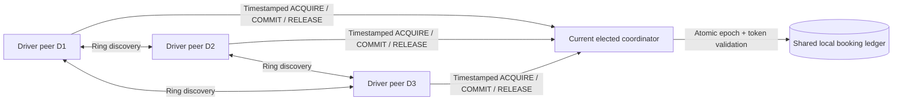

# CECS 327 - Distributed Ride-Matching System

**Milestone 4: Distributed Coordination, Logical Clocks, Leader Election & Mutual Exclusion**

This milestone extends the peer-to-peer driver overlay from Milestone 3 with distributed coordination mechanisms. Each peer node maintains a thread-safe Lamport logical clock, attaches logical timestamps to peer messages, participates in a numeric Bully leader election algorithm, and coordinates access to a shared durable SQLite driver booking ledger using centralized mutual exclusion with 5-second leases and epoch fencing.

---

## 1. Required Software
- **Python 3.10+** (Tested on Python 3.14+)
- **Visual Studio Code** (or any code editor / terminal emulator)
- **PowerShell** (Windows) or **Terminal** (macOS/Linux)

---

## 2. How to Install Dependencies
- **Standard Library Only:** This system runs entirely on Python's built-in modules (`http.server`, `socket`, `socketserver`, `threading`, `json`, `math`, `urllib`, `sqlite3`, `subprocess`, `unittest`, `argparse`, `uuid`, `pathlib`, `contextlib`, `concurrent.futures`).
- **No external packages required:** There is no `pip install` step. Allow local loopback communication if prompted by your firewall.

---

## 3. How to Start Each Service

You can run the system using **either** **Option A** (automated one-command execution) **or** **Option B** (manual multi-terminal walkthrough).

### Option A: Automated One-Command Demo & Test Suite (Complete Self-Contained Run)
To automatically run the 7-test suite and execute the entire 3-process coordination demonstration (Bully election, mutual exclusion contention, leader crash while holding a grant, failover, recovery, and causal log verification) in one shot, open a single terminal and run:

```powershell
py -m unittest -v test_coordination
py demo_coordination.py
```
*(Use `python` or `python3` on macOS/Linux).*

> **Note on Option A:** Running `py demo_coordination.py` automatically launches `D1`, `D2`, and `D3`, executes all demo steps and failure tests from Sections 4 and 5 below, and shuts the processes down cleanly. **If you run Option A, you do not need to manually execute Option B, Section 4, or Section 5.** All generated evidence is saved inside a fresh `demo-evidence/run-<id>/` folder:
> * `ordered-events.jsonl` & `events/D*-events.jsonl` — Full Lamport logical timestamps (`SEND`, `RECEIVE`, `clock`) in deterministic causal order.
> * `D1-console.log`, `D2-console.log`, `D3-console.log` — Per-node console logs showing `START`, `JOIN`, and `COORDINATOR` elections.
> * `summary.json` — Complete snapshot of initial leader (`D3`), concurrent mutex contention (`1 reserved`, `1 conflict`), leader crash failover (`D2`), stale-grant rejection (`stale_leader`), recovery, and the SQLite audit history (`GRANT`, `COMMIT`, `RELEASE`, `FENCE`).

---

### Option B: Manual Multi-Terminal Coordination Setup (For Interactive Demo & Video)
If you prefer to start each node manually and run commands interactively across split terminals, open **9 separate VS Code terminal tabs** inside the project folder if running the full integrated web stack, or **5 terminals** for the coordination-only walkthrough.

**CRITICAL STEP:** Before starting the driver or coordination nodes, make sure your `data` and `logs` directories exist, and use the single-line command block below in each terminal so all peers share the exact same SQLite booking ledger and event log directory:

- **Terminal 1 (Event Broker - Port 9200):**
  ```powershell
  py event_broker.py
  ```
- **Terminal 2 (Matching Service / Web UI Gateway - Port 9000):**
  ```powershell
  py matching_service.py
  ```
- **Terminal 3 (Audit Subscriber):**
  ```powershell
  py subscriber.py audit
  ```
- **Terminal 4 (Monitor Subscriber):**
  ```powershell
  py subscriber.py monitor
  ```
- **Terminal 5 (Driver D1 - Seed):**
  ```powershell
  $env:COORDINATION_DB = "$PWD/data/manual-take1.db"; $env:COORDINATION_LOG_DIR = "$PWD/logs/manual-take1"; py driver_service.py D1 9101 37.770 -122.410 drivers.local 9301
  ```
- **Terminal 6 (Driver D2):**
  ```powershell
  $env:COORDINATION_DB = "$PWD/data/manual-take1.db"; $env:COORDINATION_LOG_DIR = "$PWD/logs/manual-take1"; py driver_service.py D2 9102 37.790 -122.420 drivers.local 9302 127.0.0.1:9301
  ```
- **Terminal 7 (Driver D3):**
  ```powershell
  $env:COORDINATION_DB = "$PWD/data/manual-take1.db"; $env:COORDINATION_LOG_DIR = "$PWD/logs/manual-take1"; py driver_service.py D3 9103 37.760 -122.400 drivers.local 9303 127.0.0.1:9301
  ```
- **Terminal 8 (Driver D4):**
  ```powershell
  $env:COORDINATION_DB = "$PWD/data/manual-take1.db"; $env:COORDINATION_LOG_DIR = "$PWD/logs/manual-take1"; py driver_service.py D4 9104 37.780 -122.430 drivers.local 9304 127.0.0.1:9301
  ```
- **Terminal 9 (Client / Test Runner Terminal):**
  ```powershell
  $env:COORDINATION_DB = "$PWD/data/manual-take1.db"; $env:COORDINATION_LOG_DIR = "$PWD/logs/manual-take1"; py coordination_client.py 127.0.0.1:9301 status
  ```
> 🧹 **Important Note on State & Re-Testing:** 
> Because our system uses a durable SQLite coordination ledger (`COORDINATION_DB`), active locks persist across runs. If you are re-testing or recording multiple takes and encounter unexpected `"status": "conflict"` errors, perform a clean reset before starting:
> 1. Stop all running terminal processes using `Ctrl + C`.
> 2. Run the cleanup command to clear old databases and logs:
>    ```powershell
>    Remove-Item -Force data/*.db -ErrorAction SilentlyContinue; Remove-Item -Recurse -Force logs/* -ErrorAction SilentlyContinue
>    ```
> 3. Restart your services following the startup sequence above.
---

## 4. How to Run the Demo (For Option B Manual Walkthrough — Execute First)

With Terminals 1 through 8 running, wait about 2 seconds for the ring and Bully election to converge, then run the baseline checks in **Terminal 9**:

### Step 1: Verify Bully Leader Election & Shared Ledger Status
In Terminal 9, query D1 for the current coordination status:
```powershell
py coordination_client.py 127.0.0.1:9301 status
```
- **Expected Output:** Confirms the highest priority node was elected leader (`"leader": "D4"` if all 4 are running) and displays the shared `authority`, `bookings`, and `history` tables.

### Step 2: Verify Overlay Ring Connectivity & Web UI (🎥 VIDEO CUE: Show Web Browser Here)
In Terminal 9, confirm the underlying P2P ring traversal across peers:
```powershell
py peer_client.py scan 127.0.0.1:9301
```
- **Expected Output:** Returns `"status": "complete"` with `"path": ["D1", "D2", "D3", "D4"]`.

> 🎥 **VIDEO CUE (Web UI Integration Showcase):**
> * **Action for Recorder:** Switch window from VS Code to your web browser (`http://localhost:9000/`).
> * **What to show on screen:** Point out the **Peer-Discovered Driver Pool** table showing all 4 active drivers discovered via background overlay ring queries.
> * **What to say:** *"As we can see on the web console, all four driver nodes are dynamically discovered through our P2P ring overlay. When a rider submits a request, the matching service consults our SQLite coordination ledger to ensure thread-safe reservations."*

---

## 5. How to Reproduce Test Cases (For Option B Manual Walkthrough — Execute After Section 4)

Run these test cases in order to interactively verify all Milestone 4 rubric requirements:

### Test Case 1: Distributed Mutual Exclusion & Preventing Conflicting Operations (🎥 VIDEO CUE: Show Web UI Request & Terminal Conflict)
- **What this tests:** Proves that the centralized coordinator issues exclusive 5-second grants, prevents two riders from double-booking the same shared driver resource concurrently, and demonstrates full integration with the web UI dashboard.
- **Procedure:**
  1. **(Web UI Demonstration):** Open your web browser to `http://localhost:9000/`, click **Send New Request** as rider `alice`, and point out on the dashboard how the system dynamically assigns driver `D1` (with its GPS coordinates and match status changing to `MATCHED / BUSY`).
  2. Immediately switch to **Terminal 9** and submit a competing reservation for that same driver (`D1`) by rider `bob`:
     ```powershell
     py coordination_client.py 127.0.0.1:9302 reserve --resource D1 --rider bob --request-id bob-1 --hold 2
     ```
- **Expected Output:** Alice's web request succeeds and locks `D1`; Bob's terminal request returns `"status": "conflict"`.

> 🎥 **VIDEO CUE:**
> * **Action for Recorder:** Start on the browser at `http://localhost:9000/`, click the request button as rider `alice`, and narrate the `MATCHED / BUSY` status update. Then, cut over to Terminal 9 to run Bob's competing reservation.
> * **What to say:** *"First, we demonstrate our frontend web dashboard at localhost:9000, where rider Alice's request successfully triggers background matching and locks driver D1. Next, transitioning to our terminals, we put our mutual exclusion algorithm to the test: when rider Bob attempts a concurrent reservation on that exact same driver, his request is instantly rejected with a conflict status. This proves our mutual exclusion mechanism successfully prevents conflicting operations, ensuring driver resources are safely managed in our durable SQLite ledger."*

---

### Test Case 2: Idempotency & Request-ID Conflict Protection
- **What this tests:** Verifies safe retry handling and rejection of forged/reused request IDs.
- **Procedure:**
  1. Repeat the winning command in Terminal 9:
     ```powershell
     py coordination_client.py 127.0.0.1:9301 reserve --resource D1 --rider alice --request-id alice-1
     ```
  2. Reuse `alice-1` for resource `D2`:
     ```powershell
     py coordination_client.py 127.0.0.1:9301 reserve --resource D2 --rider alice --request-id alice-1
     ```
- **Expected Output:** Step 1 returns `"duplicate": true`; Step 2 returns `"status": "request_id_conflict"`.

---

### Test Case 3: Leader Failure, Automatic Replacement (Failover), & Epoch Fencing (🎥 VIDEO CUE: Show Terminal Kill & Recovery)
- **What this tests:** Proves Bully leader failover when the current coordinator crashes, and verifies that the new coordinator increments the fenced authority epoch.
- **Procedure:**
  1. Go to **Terminal 8** (Driver `D4`, the current leader) and press **Ctrl + C** to terminate it.
  2. Wait ~2 seconds for periodic probes to detect that `D4` is unreachable.
  3. In **Terminal 9**, check status and reserve driver `D2` for rider `carol`:
     ```powershell
     py coordination_client.py 127.0.0.1:9301 status
     py coordination_client.py 127.0.0.1:9301 reserve --resource D2 --rider carol --request-id carol-1
     ```
- **Expected Output:** `status` shows a new leader (`D3`) with an incremented `"epoch"`; Carol's reservation succeeds.

> 🎥 **VIDEO CUE:**
> * **Action for Recorder:** Show Terminal 8 being stopped with `Ctrl + C`, then zoom in on Terminal 9's status output showing the new leader and incremented epoch.
> * **What to say:** *"We killed our leader node D4. The Bully election algorithm automatically elected D3 as the new leader, and incremented our epoch. When we immediately send Carol's reservation request, it succeeds under the new leader, proving our epoch fencing works seamlessly."*  

---

### Test Case 4: Leader Recovery & Durable Booking Persistence
- **What this tests:** Demonstrates a higher-priority node rejoining the cluster, reclaiming leadership, and preserving earlier bookings across restarts.
- **Procedure:**
  1. In **Terminal 8**, restart `D4`:
     ```powershell
     $env:COORDINATION_DB = "$PWD/data/manual-take1.db"; $env:COORDINATION_LOG_DIR = "$PWD/logs/manual-take1"; py driver_service.py D4 9104 37.780 -122.430 drivers.local 9304 127.0.0.1:9301
     ```
  2. In **Terminal 9**, inspect status and attempt to re-book `D1`:
     ```powershell
     py coordination_client.py 127.0.0.1:9301 status
     py coordination_client.py 127.0.0.1:9301 reserve --resource D1 --rider dave --request-id dave-1
     ```
- **Expected Output:** `D4` reclaims leadership; earlier bookings remain protected and `dave` gets `"status": "conflict"`.

---

### Test Case 5: Logical Clock Verification & Deterministic Event Ordering (🎥 VIDEO CUE: Show JSONL Log Files)
- **What this tests:** Proves that every node maintains a monotonic Lamport clock and per-node logs merge into a causally valid total order.
- **Procedure:**
  Stop all running peers (`Ctrl + C`), then run the log verifier in **Terminal 9**:
  ```powershell
  py ordered_logs.py logs/manual-take1 --check
  py ordered_logs.py logs/manual-take1 > ordered-events.jsonl
  ```
- **Expected Output:** `--check` verifies `SEND.clock < RECEIVE.clock`.

> 🎥 **VIDEO CUE:**
> * **Action for Recorder:** Open `ordered-events.jsonl` in the VS Code editor on screen and scroll through the JSON records.
> * **What to say:** *"Here we verify our Lamport logical clocks. Every message carries a logical timestamp, and our merge script validates that every send event strictly precedes its corresponding receive event in causal order."*

---

## 6. Architecture, Coordination Design & Scope



| Rubric Requirement | Implementation | Visible Evidence |
| :--- | :--- | :--- |
| **Logical clock at each node** | `LogicalClock` in `coordination.py` (one per peer session) | JSONL records showing `node`, `session`, `clock`, `event_id` |
| **Logical timestamps in messages** | `_call()` and `handle_message()` in `peer_overlay.py` | `SEND`, `RECEIVE`, `SEND_REPLY`, `RECEIVE_REPLY` with linkage IDs and `remote_clock` |
| **Leader election** | Numeric Bully algorithm (`D10 > D9`, `D4 > D3 > D2 > D1`) probing higher peers every `0.6s` (`C_ELECTION` / `C_COORDINATOR`) | `ELECTED` and `LEADER` events; `status` output showing `leader` and `epoch` |
| **Distributed mutual exclusion** | Centralized coordinator issuing 5-second leased grants (`C_ACQUIRE`, `C_COMMIT`, `C_RELEASE`) bound to `(holder, epoch, token)` | `GRANT`, `COMMIT`, `RELEASE` ledger history; `CS_ENTER` / `CS_EXIT` events |
| **Shared protected resource** | Durable SQLite booking ledger (`bookings` table) integrated into `coordination_client.py` and `driver_service.py` (`/assign`) | Concurrent reservation race yields 1 `reserved` and 1 `conflict` |
| **Event ordering** | Offline deterministic merge by `(clock, node, session)` in `ordered_logs.py` | `ordered-events.jsonl` and causal pair verification |
| **Leader failure & replacement** | Timeout detection (`0.4s` per probe), replacement leader election, and atomic SQLite epoch fencing (`FENCE`) | `D4` crash -> `D3` elected with new epoch; stale grant rejected; `D4` recovery |

- **Scope & Assumptions:** This is a same-host, multi-process teaching implementation where all local peer processes coordinate over raw TCP sockets and share a local SQLite database file (`COORDINATION_DB`) as the shared resource authority and fencing boundary. It implements centralized mutual exclusion and timeout-based Bully election rather than multi-host replicated state machine consensus (Raft/Paxos).

---

## 7. Files and Port Allocations

| File | Role |
| :--- | :--- |
| `coordination.py` | Implements `LogicalClock` (Lamport timestamps), numeric Bully election, centralized mutex (`ACQUIRE`/`COMMIT`/`RELEASE`), and the fenced SQLite `Ledger` |
| `coordination_node.py` | Standalone peer runner for launching `PeerNode` instances with Bully election and mutual exclusion |
| `coordination_client.py` | CLI tool to inspect coordination `status` or execute `reserve` requests against any peer port |
| `ordered_logs.py` | Merges per-node `*-events.jsonl` files in `(clock, node, session)` order and verifies causal `SEND -> RECEIVE` timestamp inequalities |
| `demo_coordination.py` | Automated multi-process demo testing Bully election, concurrent mutex contention, leader crash while holding a grant, stale-token rejection, and recovery |
| `test_coordination.py` | 7-test `unittest` suite validating Lamport clocks, Bully priority, lease expiry, epoch fencing, multi-process failover, and HTTP `/assign` reservation |
| `peer_overlay.py` | P2P TCP ring engine instrumented to attach and update Lamport logical clocks on every peer message and check durable bookings during discovery |
| `driver_service.py` | Full driver service (HTTP `/assign` + P2P node + pub-sub listener); reserves drivers through the elected coordinator before accepting rides |
| `matching_service.py` | HTTP gateway and web dashboard (`http://localhost:9000/`); discovers available drivers via the P2P overlay |
| `peer_client.py` | CLI utility for querying P2P ring `status`, `lookup <driver>`, or `scan` |
| `rider_client.py` | CLI rider client for submitting HTTP ride requests |
| `event_broker.py` / `messaging.py` / `subscriber.py` / `group_client.py` | TCP pub-sub event broker and multicast group notification components |
| `demo_marshall.py` / `clean_logs.py` | JSON wire marshalling demonstration and application log cleanup utility |

**Default Ports:** Driver Peer & Coordination TCP `9301–9304`; Driver HTTP `9101–9104`; Matching Service HTTP `9000`; Event Broker TCP `9200`.
